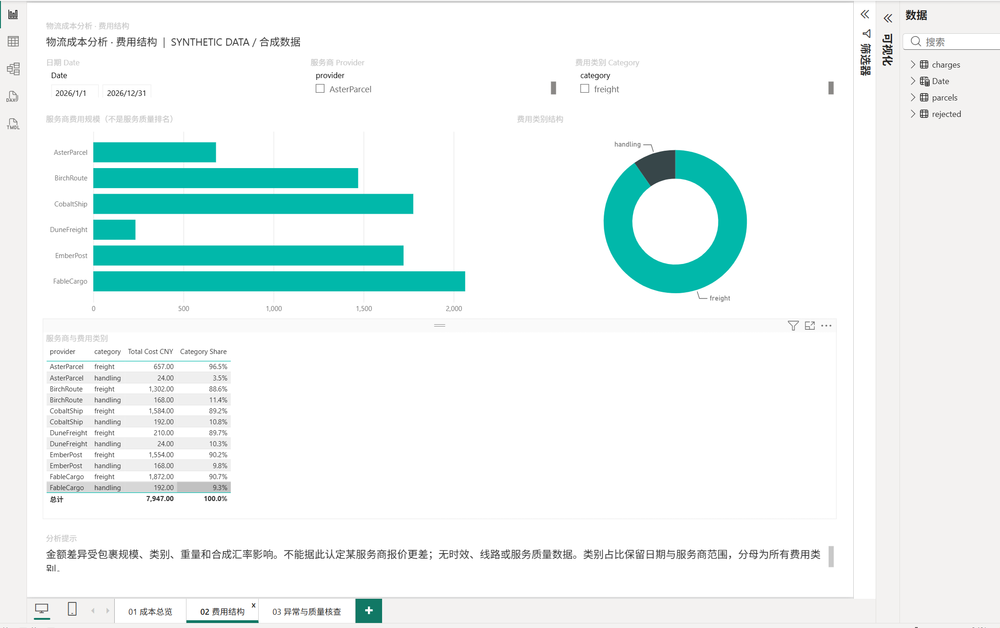

# logistics-cost-analysis

**可复现的合成数据分析项目**，面向供应链数据分析、业务数据治理及 BI 岗位。
包含 **144条有效费用明细、72个包裹、144件商品、6家虚构服务商**，覆盖2026年1—3月。

所有服务商、账单、跟踪号、金额、汇率和场景均为独立生成的虚构数据，
不是公司数据的脱敏副本。演示规模不代表真实实习项目业务量，不声称产生真实降本成果。

## 分析与治理流程

合成Excel → 配置映射 → Python ETL → SQLite → CSV → SQL分析 / Power BI

- Python：多表头与日期格式适配、重量单位和币种转换、必填及类型检查。
- 治理：文件指纹、重复与冲突检查、事务回滚、拒绝记录与来源行号追踪。
- SQL：月度成本及环比、服务商/类别结构、单票/单件运费、高费用核查。
- Power BI：成本总览、费用结构、异常与质量核查三个页面。
- 无收入、利润、时效或服务质量数据，不展示这些指标，不将高费用标记解释为实际错账。

## 快速复现

需要Python 3.11+。在项目根目录执行（首次安装依赖需要网络）：

~~~powershell
python -m venv .venv
.venv\Scripts\python -m pip install -r requirements.txt
.venv\Scripts\python -m src.etl
.venv\Scripts\python -m src.etl
.venv\Scripts\python -m src.analyze
.venv\Scripts\python -m unittest discover -s tests -v
.venv\Scripts\python powerbi/validate_demo.py
~~~

依赖安装后，默认ETL和SQLite分析只处理本地合成数据，不需要数据库服务器或业务API。
仓库已包含六份合成Excel。如需重新生成，可运行 python -m src.generate_sample。
Excel容器时间戳可能改变文件指纹；已有runtime时按提示运行
python -m src.etl --rebuild，仅重建本项目演示库。
不要对正在Desktop编辑的项目重复运行Power BI构建器，它会重建页面定义。

首次ETL预期：144条有效费用、6条重复被跳过、18条拒绝记录。
第二次运行应跳过6份文件。质量报告的本次新增数与累计数不能混用。

## 指标基准

| 指标 | 合成数据预期 |
|---|---:|
| 总费用 CNY | 7,947.00 |
| 1 / 2 / 3月费用 | 2,360 / 2,488 / 3,099 |
| 包裹数 / 商品件数 | 72 / 144 |
| 运费 CNY | 7,179.00 |
| 单票 / 单件运费 CNY | 99.708333 / 49.854167 |
| 高费用待核查 | 1条，500元 |
| 拒绝记录 | 18条 |

件数从包裹表统计，不能在费用行重复求和。金额用整数分汇总；
汇率是显式配置的合成值，不宣称市场汇率准确性。
详见[指标定义](docs/metrics.md)、[数据字典](docs/data_dictionary.md)。

## Power BI 打开方式

打开 [LogisticsCostDemo.pbip](powerbi/LogisticsCostDemo/LogisticsCostDemo.pbip)，
保留旁边的 .Report、.SemanticModel 目录。
在“转换数据 → 管理参数”中，将 DataFolder 改为下载目录下 data/demo 的绝对路径，
再关闭并应用。PBIP不包含缓存，首次打开需要载入这些CSV。
只查看演示无需运行Python或MySQL。完整说明：[操作指南](powerbi/README.md)。

日期表→包裹→费用，关系单向。类别只影响费用，不缩小包裹/件数分母；
仅选handling时运费卡片为空。拒绝表独立，保持全量18条，不随筛选变化。

## 看板预览：用户提供的历史截图，非最终版

以下是真实Desktop截图，已在早期版本核对主要数值。
**截图早于最后的布局、环比总计及异常默认筛选修正，仅展示历史运行情况，
不能代表最新PBIP的最终效果。**用户已确认最终Desktop验证通过，但新版截图尚未在本项目找到，仍待文件核查和替换。

### 成本总览（历史预览）

### 费用结构（历史预览）

### 异常与质量核查（历史预览）

新版截图保存到 powerbi/screenshots/01-overview.png、02-structure.png、
03-quality.png。通过验证后才把上面的图片链接切换为新版。
见[截图清单](powerbi/screenshots/README.md)。

## 验证状态

| 项目 | 状态 |
|---|---|
| Python ETL、SQLite五条分析、合成数据口径 | 自动化验证通过，详见测试报告 |
| CSV换行、SHA256、本地与Git clean过滤 | 自动化回归检查，详见测试报告 |
| PBIP关系、字段绑定、JSON格式 | 静态检查通过 |
| 三页早期Desktop呈现及主要数值 | 用户实际截图已确认 |
| 最后布局、交互、环比总计和异常默认过滤 | 用户已确认Desktop验证完成；新截图尚未找到，待核查文件 |
| 独立二进制PBIX | 尚未另存，建议最终验证后补充 |
| MySQL适配器 | 仅本机沙盒可选，未做服务器集成测试 |
| 生产部署、真实性能收益或节省金额 | 不在演示验证范围 |

[测试报告](docs/test_report.md) · [发布检查](docs/release_check.md) ·
[Power BI验证记录](powerbi/VALIDATION.md)

## 固定数据与跨平台完整性

data/demo 是可提交的固定合成快照，UTF-8无BOM、LF换行。
.gitattributes 对CSV显式设置 text eol=lf，manifest.json 保存实际字节SHA256。
校验严格检查规范格式与哈希，不通过忽略数据差异来绕过校验。
生成器使用同样规范；Windows与Git clean处理后的内容应一致。

data/output 是ETL产物，默认忽略；Power BI使用固定data/demo。
有意更新样本后才使用 python powerbi/build_demo.py 重建项目与快照，
随后重新验证；这会覆盖独立演示页面定义。

## GitHub文件范围

保留：源码、SQL、配置、测试、依赖、data/sample、data/demo、
完整PBIP、DAX/M与说明、明确标记的历史预览或最终真实截图，
以及可选的已验证演示PBIX。
忽略：runtime、data/output、.venv、.pbi、.env*、缓存、临时文件。
本项目不需要公司文件、共享盘或真实服务凭据，不要把其他工作目录加入仓库。

可选MySQL仅支持本机logistics_demo，使用环境变量配置；常规复现无需运行
src.load_mysql。SQL与适配器不等于已通过MySQL集成测试。
尚未选择代码许可证；公开前决定本人原创部分的复用授权范围。
